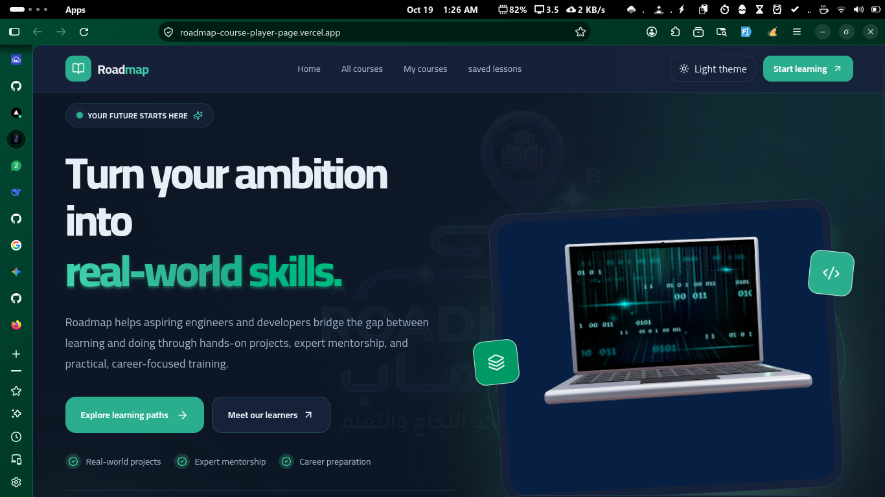
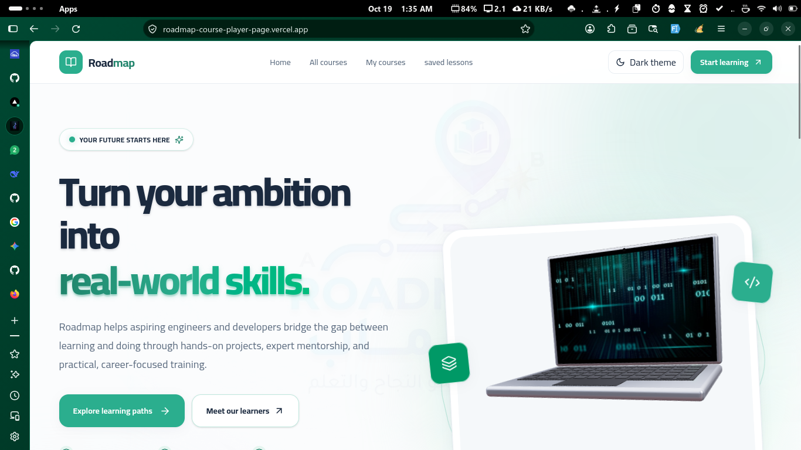
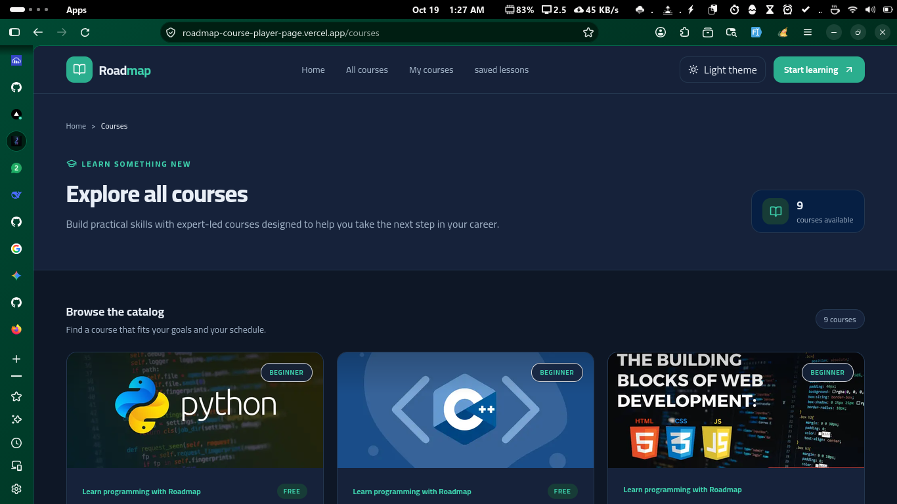
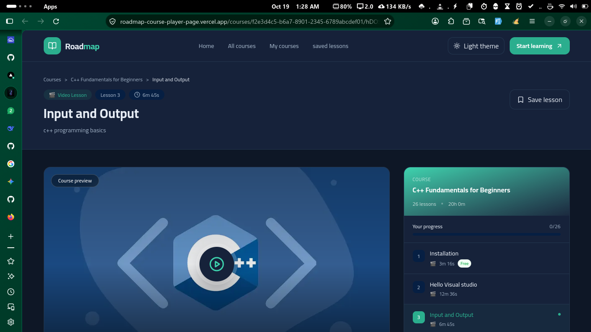

# Roadmap Academy

[عرض النسخة الحية](https://roadmap-course-player-page.vercel.app/)

منصة تعليمية لعرض الدورات ومحتواها، ومشاهدة دروس الفيديو، والاحتفاظ بالدروس التي تريد الرجوع إليها. بُني المشروع باستخدام Next.js وReact وTypeScript، مع تصميم متجاوب يدعم الوضعين الفاتح والداكن.

## لقطات من التطبيق

| الصفحة الرئيسية — الوضع الداكن | الصفحة الرئيسية — الوضع الفاتح |
| --- | --- |
|  |  |

| استعراض الدورات | مشاهدة درس |
| --- | --- |
|  |  |

## المزايا

- صفحة رئيسية تعرض مقدمة المنصة والدورات المميزة وآراء المتعلمين.
- تصفح الدورات وصفحة مستقلة لتفاصيل كل دورة ومحتواها.
- جلب الدروس من قوائم تشغيل YouTube وعرضها ضمن صفحات الدورات.
- حفظ الدروس وإزالتها من قائمة المحفوظات؛ تُحفظ القائمة محليًا في المتصفح.
- صفحة للدورات التي أضيفت إلى قائمة المستخدم.
- بحث ضمن الدروس المحفوظة، مع حالات واضحة للقائمة الفارغة وعدم وجود نتائج.
- تصميم متجاوب مع دعم الوضع الداكن والفاتح.

## المتطلبات

- Node.js متوافق مع إصدار Next.js المستخدم في المشروع.
- npm.
- مفتاح YouTube Data API v3 لجلب محتوى قوائم التشغيل.

## البدء

1. ثبّت الاعتماديات:

   ```bash
   npm install
   ```

2. أنشئ ملف `.env.local` في جذر المشروع وأضف إعدادات البيئة:

   ```env
   YOUTUBE_API_KEY=your_youtube_data_api_key
   NEXT_PUBLIC_API_URL=http://localhost:3000
   ```

   `YOUTUBE_API_KEY` مطلوب لواجهة جلب الدروس. أما `NEXT_PUBLIC_API_URL` فهو اختياري محليًا، إذ يستخدم التطبيق `http://localhost:3000` افتراضيًا. عند نشر التطبيق، اضبطه على عنوان التطبيق العام. لا تضع مفتاح YouTube في متغير يبدأ بـ `NEXT_PUBLIC_`، ولا تشارك ملف البيئة أو ترفعه إلى Git.

3. شغّل خادم التطوير:

   ```bash
   npm run dev
   ```

4. افتح [http://localhost:3000](http://localhost:3000).

## الأوامر

| الأمر | الوصف |
| --- | --- |
| `npm run dev` | تشغيل خادم التطوير |
| `npm run build` | إنشاء نسخة الإنتاج |
| `npm run start` | تشغيل نسخة الإنتاج بعد بنائها |
| `npm run lint` | تشغيل ESLint |
| `npm run typecheck` | التحقق من أنواع TypeScript |

## المسارات

| المسار | المحتوى |
| --- | --- |
| `/` | الصفحة الرئيسية |
| `/courses` | استعراض الدورات |
| `/courses/[course]` | تفاصيل دورة |
| `/courses/[course]/[lesson]` | مشاهدة درس |
| `/lessons/saved` | الدروس المحفوظة |
| `/my-courses` | الدورات المضافة إلى قائمة المستخدم |

## جلب دروس YouTube

تُعرّف الدورات في `data/courses.ts`، ويُستخرج معرّف قائمة التشغيل من رابط فيديو العرض الترويجي للدورة. عند طلب دروس دورة، يستدعي التطبيق المسار:

```text
/api/courses/[courseId]/[YOUTUBE_PLAYLIST_ID]
```

تستخدم واجهة API المفتاح المخزّن في `YOUTUBE_API_KEY` لجلب عناصر قائمة التشغيل وتفاصيل الفيديو ومدته وصورته المصغّرة. تُخزّن الدورات والدروس المحمّلة والدروس المحفوظة في حالة Zustand المستمرة في المتصفح، لذلك تبقى قائمة الدروس المحفوظة على الجهاز نفسه.

## التقنيات

- Next.js 16 مع App Router
- React 19 وTypeScript
- Tailwind CSS 4
- Zustand للحالة والتخزين المحلي
- next-themes لتبديل السمة
- YouTube Data API عبر `googleapis`
- Lucide React للأيقونات
